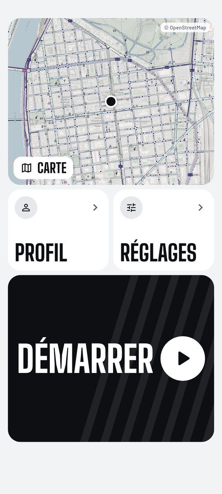
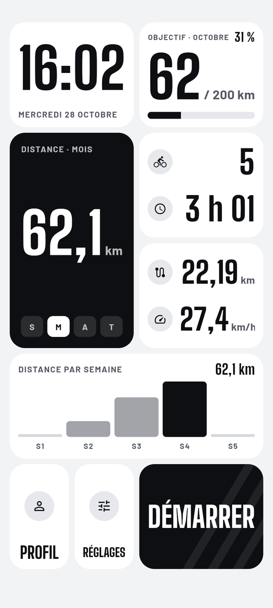
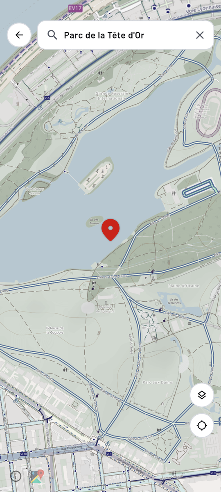
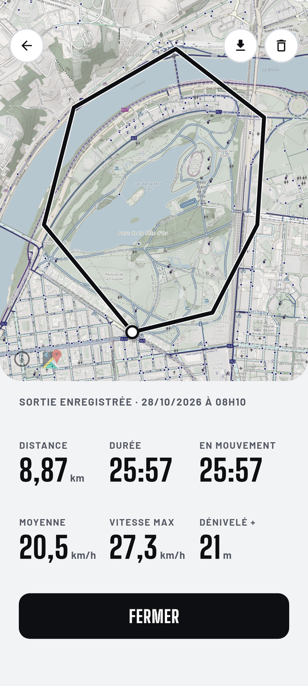

# Compteur Vélo

**Le compteur GPS pour le vélo, lisible d'un coup d'œil, les mains sur le guidon.**

Version <!-- version -->0.1.27<!-- /version --> · gratuit · sans compte · sans publicité

<!-- screenshots:start -->

<table><tr><td></td><td></td><td></td><td></td></tr></table>

<!-- screenshots:end -->

## Ce que fait l'app

- **Enregistrement GPS précis** : vitesse, distance, durée, temps en mouvement, moyenne, vitesse max et dénivelé, avec un filtrage du bruit GPS.
- **Altitude réelle** au-dessus du niveau de la mer, corrigée par le modèle de géoïde EGM96.
- **Accueil en tuiles personnalisable** : appui long pour déplacer et redimensionner les tuiles, et ajouter des widgets (distance, graphique, records, objectif du mois, dernière sortie, heure).
- **Carte vélo CyclOSM** avec recherche de lieu, en thème clair ou sombre.
- **Historique et statistiques** par semaine, mois, année ou au total, avec les records.
- **Export GPX** de chaque sortie, ou de toutes, dans le dossier Téléchargements.
- **Mises à jour intégrées** : l'app propose elle-même chaque nouvelle version.

## Nouveautés de la version <!-- version -->0.1.27<!-- /version -->

<!-- notes:start -->
- Récap d'une sortie complet et mieux ordonné : parcours, temps (départ, arrivée, arrêts), vitesse (moyenne, moyenne en mouvement, max, courbe de vitesse), altitude (dénivelé + et −, altitude min et max, pente max, profil d'altitude). On peut glisser le doigt sur les courbes pour lire une valeur.
- Étiquette de sortie : Pro, Loisir ou Autre. Elle est choisie automatiquement : si une sortie déjà étiquetée a un départ et une arrivée à moins de 300 m (dans un sens ou dans l'autre), elle reprend son étiquette, sinon « Autre ». On la change d'un appui sur l'étiquette.
- Profil : un appui sur une barre du graphique affiche les kilomètres et les sorties de la période (touchables) ; série de jours consécutifs (actuelle et record) ; jauge de l'objectif du mois.
- Modification des écrans : pour régler un widget (apparence, mode de la lampe, son du klaxon), reste appuyé 2 s dessus ; un anneau se remplit. Le petit bouton de réglage disparaît.
- Page Dispositions : l'onglet « Prédéfinies » passe avant « Mes dispositions ».
<!-- notes:end -->

## Installation

1. Sur ton téléphone Android, touche **Télécharger l'APK** ci-dessus.
2. Ouvre le fichier téléchargé. Si Android le demande, autorise l'installation depuis ton navigateur ou ton gestionnaire de fichiers.
3. Lance **Compteur Vélo** et autorise la localisation pour enregistrer tes sorties.

Les versions suivantes s'installent depuis l'app : une pop-up te propose chaque nouvelle version.

## Données et confidentialité

- Tes sorties restent sur ton téléphone. Il n'y a ni compte, ni serveur, ni statistiques d'usage.
- L'app accède à Internet uniquement pour afficher la carte (OpenStreetMap / CyclOSM), rechercher un lieu (Photon) et vérifier les mises à jour (GitHub).

## Crédits

Carte © contributeurs [OpenStreetMap](https://www.openstreetmap.org/copyright), style [CyclOSM](https://www.cyclosm.org) · Recherche [Photon](https://photon.komoot.io) par komoot · Géoïde EGM96 (NGA) · Polices Big Shoulders Display et Barlow (SIL Open Font License).

Toutes les versions sont dans [Releases](https://github.com/HugoinTheGit/gps-velo-apk/releases). Le code source de l'app est privé.
