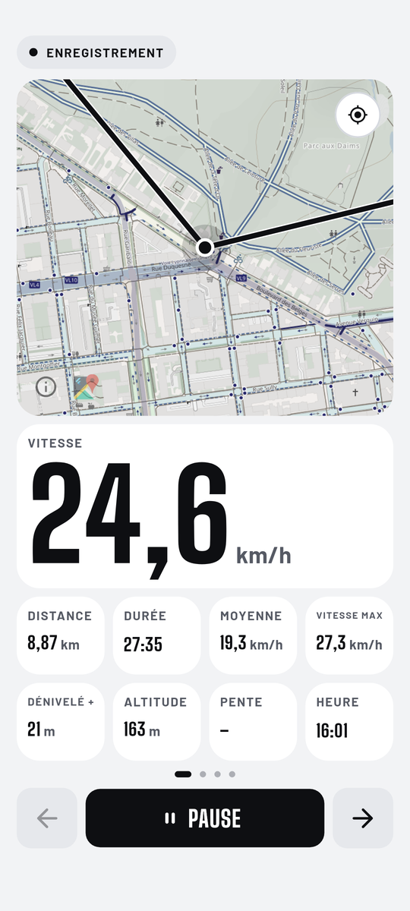
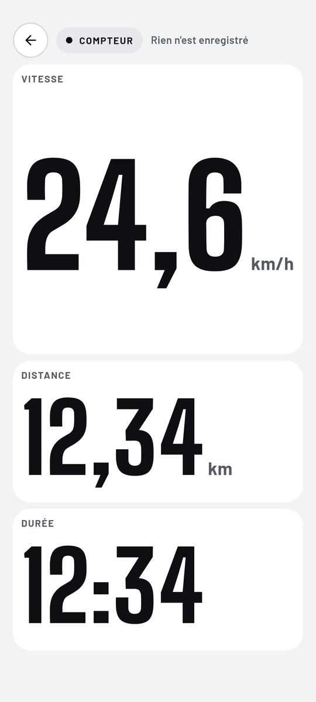

# Compteur Vélo

**L'app vélo ultime : un compteur GPS que tu configures comme tu veux, pour tous les types de cyclistes.**

> 🧪 **Version en cours de développement et de test.** Tu peux l'essayer sans crainte et
> **envoyer tes retours** (bugs, idées, ce qui manque) dans l'onglet
> [Issues](https://github.com/HugoinTheGit/gps-velo-apk/issues) : chaque avis compte.

Version <!-- version -->0.1.32<!-- /version --> · gratuit · sans compte · sans publicité

<!-- screenshots:start -->

<table><tr><td></td><td></td><td></td><td></td></tr></table>

<!-- screenshots:end -->

## Une app qui s'adapte à toi

Route, VTT, gravel, ville, randonnée, long voyage : chaque cycliste a ses chiffres
préférés. Compteur Vélo se façonne à ta mesure.

- **Modulaire** : l'accueil et l'écran d'enregistrement sont des grilles de widgets.
  Tu choisis ce qui s'affiche (vitesse, distance, pente, altitude, carte, courbes,
  musique, lampe, klaxon...), tu les places, tu les redimensionnes.
- **Plusieurs pages** : une disposition pour la route, une pour les longues sorties,
  une pour la ville. Tu passes de l'une à l'autre en glissant.
- **Personnalisable** : chaque widget peut être automatique, sombre, clair ou en couleur
  d'accent, et chaque vélo a sa couleur et ses dispositions.
- **Des dispositions prêtes à l'emploi** : départ rapide, carte grand format, classique...
  ou enregistre les tiennes.
- **Un compteur sans enregistrement** : vitesse, distance et durée à la volée, sans
  garder la sortie.

## Ce que fait l'app

- **Enregistrement GPS précis** : vitesse, distance, durée, temps en mouvement, moyenne, vitesse max et dénivelé, avec un filtrage du bruit GPS.
- **Altitude réelle** au-dessus du niveau de la mer, corrigée par le modèle de géoïde EGM96.
- **Accueil en tuiles personnalisable** : appui long pour déplacer et redimensionner les tuiles, et ajouter des widgets (distance, graphique, records, objectif du mois, dernière sortie, heure, compteur).
- **Widget musique** : pochette et commandes de la musique en cours (autorisation « accès aux notifications »).
- **Carte vélo CyclOSM** avec recherche de lieu, en thème clair ou sombre.
- **Historique et statistiques** par semaine, mois, année ou au total, avec les records.
- **Profil de sortie** : graphiques de vitesse et d'altitude (avec la pente), temps d'arrêt, étiquette pro, loisir ou autre.
- **Export GPX** de chaque sortie, ou de toutes, dans le dossier Téléchargements.
- **Mises à jour intégrées** : l'app propose elle-même chaque nouvelle version.

## Nouveautés de la version <!-- version -->0.1.32<!-- /version -->

<!-- notes:start -->
- Nouveau widget « Compteur » pour l'accueil (dans Ajouter un widget) : un second bouton Démarrer qui ouvre un compteur de vitesse, distance et durée, actif dès l'ouverture, sans rien enregistrer. Quand tu quittes la page, les chiffres sont gardés 1 minute (tu peux revenir sans rien perdre), puis tout est remis à zéro. Les widgets du compteur ne se déplacent pas mais leur apparence se règle par un appui long. Pas disponible pendant une sortie enregistrée.
- Widget Musique refait : petits formats sans texte (pochette plein widget avec un gros bouton lecture, ou pochette carrée et bouton lecture sur les bandes), grands formats avec titre et artiste et des boutons beaucoup plus gros, à l'échelle du widget.
- Fin de trajet : « Enregistrer » ou « Supprimer » (avec confirmation) à la place de « Fermer ». Si tu quittes sans choisir, la sortie est enregistrée quand même.
- Le bouton Reprendre clignote doucement sur l'accueil quand une sortie est en cours.
- Graphique de vitesse : plus de pic faux au départ (GPS pas encore stable), la courbe ne dépasse jamais ta vitesse max réelle.
- Profil d'altitude : la pente locale en % s'affiche à côté des mètres quand tu glisses le doigt.
- Mes dispositions : les aperçus de pages reprennent la vraie couleur de chaque widget.
- Sonnette et klaxon : sortie forcée sur le haut-parleur du téléphone, même avec des écouteurs (si le problème persiste sur ton téléphone, dis-le moi).
<!-- notes:end -->

## Tester et donner ton avis

L'app évolue vite. Si tu trouves un bug, un écran peu clair ou une fonction qui te manque,
dis-le dans les [Issues](https://github.com/HugoinTheGit/gps-velo-apk/issues) : indique ton
téléphone, la version et ce que tu faisais. Les mises à jour arrivent directement dans l'app.

## Installation

1. Sur ton téléphone Android, touche **Télécharger l'APK** ci-dessus.
2. Ouvre le fichier téléchargé. Si Android le demande, autorise l'installation depuis ton navigateur ou ton gestionnaire de fichiers.
3. Lance **Compteur Vélo** et autorise la localisation pour enregistrer tes sorties.

Les versions suivantes s'installent depuis l'app : une pop-up te propose chaque nouvelle version.

## Données et confidentialité

- Tes sorties restent sur ton téléphone. Il n'y a ni compte, ni serveur, ni statistiques d'usage.
- L'app accède à Internet uniquement pour afficher la carte (OpenStreetMap / CyclOSM), rechercher un lieu (Photon) et vérifier les mises à jour (GitHub).

## Crédits

Carte © contributeurs [OpenStreetMap](https://www.openstreetmap.org/copyright), style [CyclOSM](https://www.cyclosm.org) · Recherche [Photon](https://photon.komoot.io) par komoot · Géoïde EGM96 (NGA) · Polices Big Shoulders Display et Barlow (SIL Open Font License).

Toutes les versions sont dans [Releases](https://github.com/HugoinTheGit/gps-velo-apk/releases). Le code source de l'app est privé.
