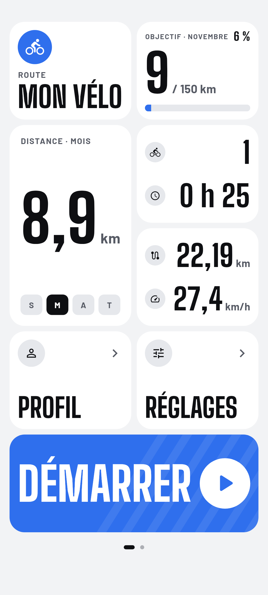
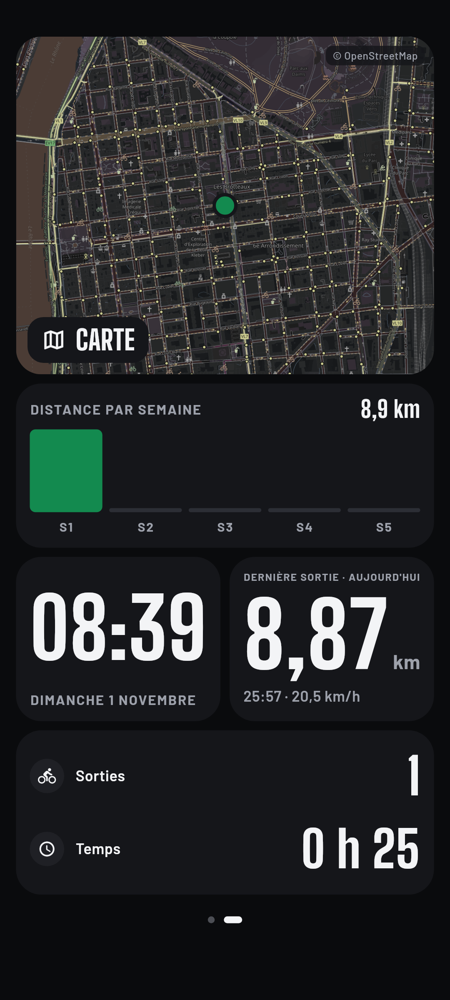
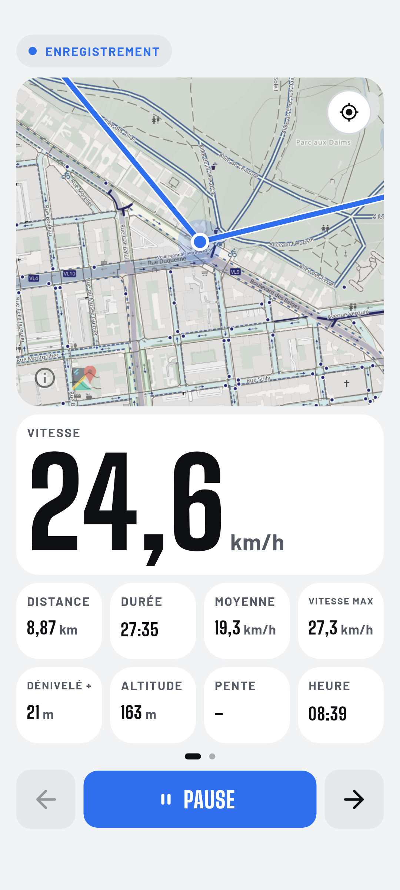
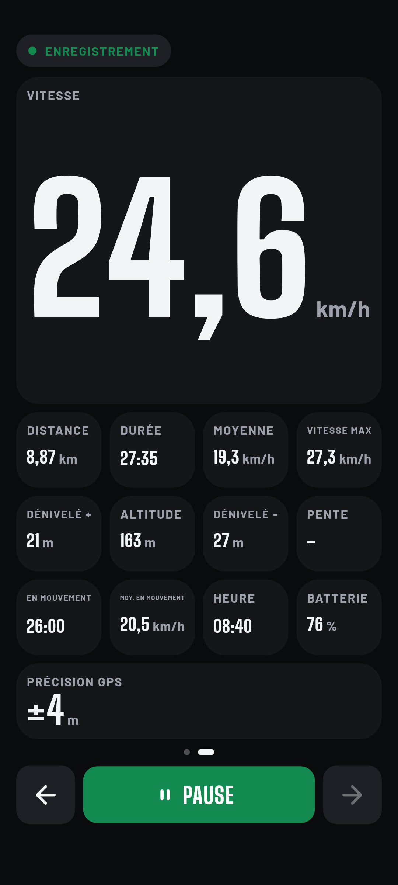

# BIKE TOOL

**L'app vélo ultime : un compteur GPS que tu configures comme tu veux, pour tous les types de cyclistes.**

> 🧪 **Version en cours de développement et de test.** Tu peux l'essayer sans crainte et
> **envoyer tes retours** (bugs, idées, ce qui manque) dans l'onglet
> [Issues](https://github.com/HugoinTheGit/gps-velo-apk/issues) : chaque avis compte.

Version <!-- version -->0.1.56<!-- /version --> · gratuit · sans compte · sans publicité

<!-- screenshots:start -->

<table><tr><td></td><td></td><td></td><td></td></tr></table>

<!-- screenshots:end -->

## Les fonctions essentielles

- **Enregistrement GPS précis** : vitesse, distance, durée, temps en mouvement, moyenne, vitesse max et dénivelé, avec un filtrage du bruit GPS.
- **Altitude réelle** au-dessus du niveau de la mer, corrigée par le modèle de géoïde EGM96.
- **Accueil en tuiles personnalisable** : appui long pour déplacer et redimensionner les tuiles, et ajouter des widgets (distance, graphique, records, objectif du mois, dernière sortie, heure, météo, compteur).
- **Widget musique** : pochette et commandes de la musique en cours (autorisation « accès aux notifications »).
- **Carte vélo CyclOSM** avec recherche de lieu, en thème clair ou sombre.
- **Historique et statistiques** par semaine, mois, année ou au total, avec les records.
- **Profil de sortie** : graphiques de vitesse et d'altitude (avec la pente), temps d'arrêt, étiquette pro, loisir ou autre.
- **Export GPX** de chaque sortie, ou de toutes, dans le dossier Téléchargements.
- **Mises à jour intégrées** : l'app propose elle-même chaque nouvelle version.

## Une app qui s'adapte à toi

Route, VTT, gravel, ville, randonnée, long voyage : chaque cycliste a ses chiffres
préférés. BIKE TOOL se façonne à ta mesure.

- **Modulaire** : l'accueil et l'écran d'enregistrement sont des grilles de widgets.
  Tu choisis ce qui s'affiche (vitesse, distance, pente, altitude, carte, courbes,
  musique, lampe, klaxon...), tu les places, tu les redimensionnes.
- **Plusieurs pages** : une disposition pour la route, une pour les longues sorties,
  une pour la ville. Tu passes de l'une à l'autre en glissant.
- **Personnalisable** : chaque widget peut être automatique, sombre, clair ou en couleur
  d'accent, et chaque vélo a sa couleur et ses dispositions.
- **Des dispositions prêtes à l'emploi** : départ rapide, carte grand format, classique...
  ou enregistre les tiennes.
- **Un compteur sans enregistrement** : vitesse, distance et durée à la volée, sans
  garder la sortie.

## Tester et donner ton avis

L'app évolue vite. Si tu trouves un bug, un écran peu clair ou une fonction qui te manque,
dis-le dans les [Issues](https://github.com/HugoinTheGit/gps-velo-apk/issues) : indique ton
téléphone, la version et ce que tu faisais. Les mises à jour arrivent directement dans l'app.

## Installation

1. Sur ton téléphone Android, touche **Télécharger l'APK** ci-dessus.
2. Ouvre le fichier téléchargé. Si Android le demande, autorise l'installation depuis ton navigateur ou ton gestionnaire de fichiers.
3. Lance **BIKE TOOL** et autorise la localisation pour enregistrer tes sorties.

Les versions suivantes s'installent depuis l'app : une pop-up te propose chaque nouvelle version.

## Données et confidentialité

- Tes sorties restent sur ton téléphone. Il n'y a ni compte, ni serveur, ni statistiques d'usage.
- L'app accède à Internet uniquement pour afficher la carte (OpenStreetMap / CyclOSM), rechercher un lieu (Photon), vérifier les mises à jour (GitHub) et, si tu ajoutes le widget Météo, récupérer la météo de la ville que tu as choisie (Open-Meteo). Ta position n'est jamais envoyée pour la météo.

## Crédits

Carte © contributeurs [OpenStreetMap](https://www.openstreetmap.org/copyright), style [CyclOSM](https://www.cyclosm.org) · Recherche [Photon](https://photon.komoot.io) par komoot · Géoïde EGM96 (NGA) · Polices Big Shoulders Display et Barlow (SIL Open Font License).

Toutes les versions sont dans [Releases](https://github.com/HugoinTheGit/gps-velo-apk/releases). Le code source de l'app est privé.
